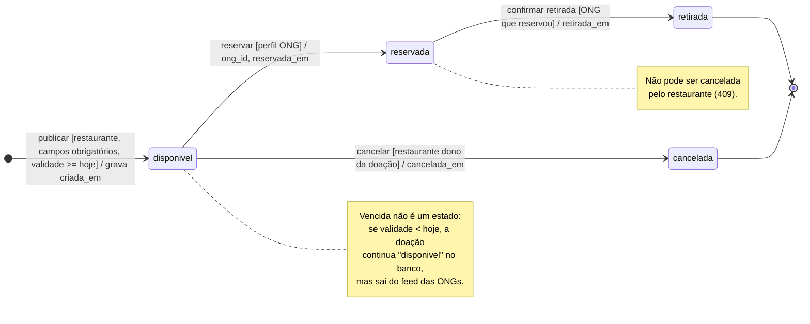

# Diagrama de Estados da Doação — versão final

Responde: **quais estados uma doação pode assumir, quem provoca cada mudança e o que é
proibido?** Confrontado com `src/doacoes.js`, `src/repositorio.js` e a coluna `status` da
tabela `doacoes` (`src/db.js`).

## Como ler

- Os nomes dos estados são **exatamente** os valores gravados em `doacoes.status`.
- `[...]` é a **guarda**: a condição que precisa ser verdadeira. No código, ela é o
  `WHERE` do `UPDATE` (ADR 0002), por exemplo
  `WHERE id = ? AND status = 'disponivel' AND restaurante_id = ?`.
- `/ ...` é o **efeito**: as colunas preenchidas na transição.
- **Qualquer transição que não está desenhada é recusada:** o sistema responde `409`
  (estado não permite), `403` (perfil ou dono errado) ou `404` (doação não existe).

| Evento | Rota | De → para | Erros possíveis |
|---|---|---|---|
| publicar | `POST /api/doacoes` | início → `disponivel` | 400 (campo faltando, data inválida ou no passado), 403 |
| reservar | `POST /api/doacoes/:id/reservar` | `disponivel` → `reservada` | 403, 404, 409 |
| cancelar | `POST /api/doacoes/:id/cancelar` | `disponivel` → `cancelada` | 403, 404, 409 |
| confirmar retirada | `POST /api/doacoes/:id/retirada` | `reservada` → `retirada` | 403, 404, 409 |

Testes que provam cada transição e cada recusa: `tests/doacoes.test.js`,
`tests/validade.test.js`, `tests/cancelamento.test.js` e `tests/retirada.test.js`.
