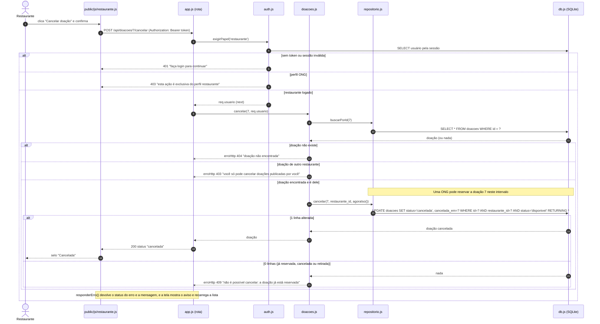

# Diagrama de Sequência — cancelar doação (versão final)

Responde: **como as partes do sistema colaboram para cancelar uma doação, e o que acontece
quando uma ONG reserva a mesma doação no mesmo instante?** Os participantes são os módulos
reais do repositório.

## Decisões que o diagrama torna visíveis

- **A leitura com `buscarPorId` não autoriza nada.** Ela só escolhe a mensagem de erro. Quem decide
  se o cancelamento acontece é o `UPDATE` condicional (o `UPDATE ... WHERE status = 'disponivel'`), que é atômico no banco.
  Por isso a reserva concorrente nunca gera uma doação cancelada e reservada ao mesmo
  tempo (ADR 0002).
- **Cancelar é um `UPDATE` de status, não um `DELETE`.** O histórico fica no painel do
  restaurante.
- **Duas camadas de autorização:** perfil em `auth.js` (401/403) e dono da doação em
  `doacoes.js` (403).
- **Só `db.js` fala com o SQLite.** Na migração para PostgreSQL (ADR 0001), apenas o último
  participante muda.
