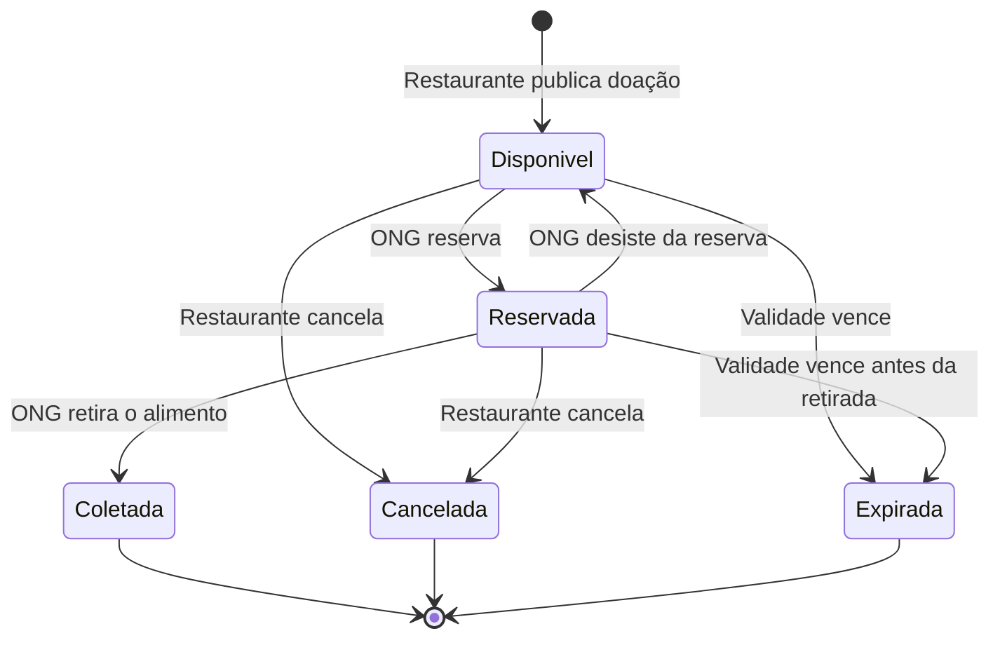

# Diagrama de Estados da Doação — versão original da IA

> **Versão gerada pela IA, sem nenhuma correção.** Guardada aqui para comparação.
> Ferramenta: Claude (Anthropic). O prompt usado está em [`../README.md`](../README.md#prompt-usado).

Explicação dada pela IA junto com o diagrama:

> A doação começa como **Disponível** quando o restaurante a publica. Uma ONG pode
> **reservá-la**, e a reserva pode ser desfeita, voltando a doação para Disponível. Se o
> prazo de validade passar, a doação **expira** automaticamente. O restaurante pode cancelar
> a doação a qualquer momento antes da coleta. O ciclo termina quando a ONG **coleta** o
> alimento.
