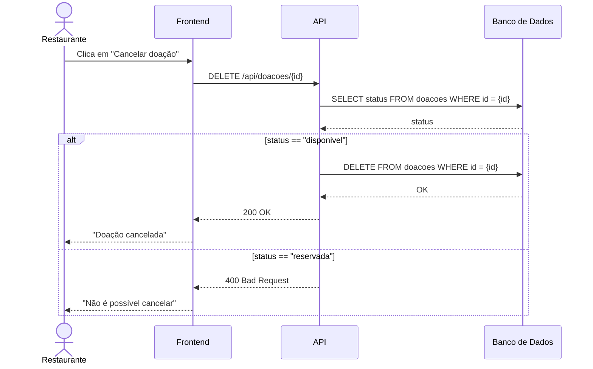

# Diagrama de Sequência — versão original da IA

> **Versão gerada pela IA, sem nenhuma correção.** Guardada aqui para comparação.
> Ferramenta: Claude (Anthropic). O prompt usado está em [`../README.md`](../README.md#prompt-usado).

Operação pedida: **"o restaurante cancela uma doação"**.

Explicação dada pela IA junto com o diagrama:

> O frontend envia uma requisição DELETE para a API. A API consulta o status da doação e,
> se ela ainda estiver disponível, remove o registro do banco. Caso já tenha sido reservada,
> retorna erro 400 informando que o cancelamento não é permitido.
