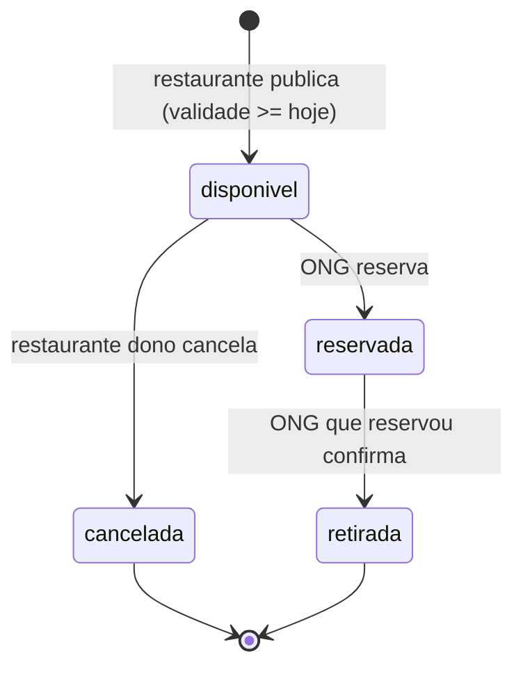
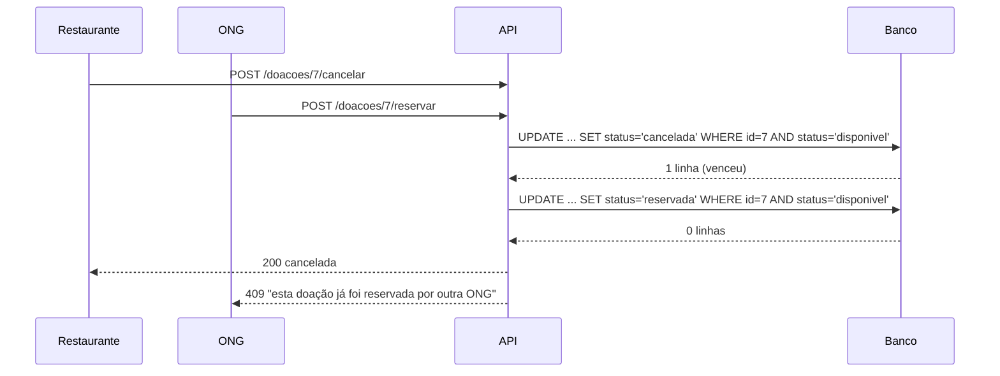

# Documento de Projeto — Prato Cheio

*Trabalho 2 · Entrega 2 · branch `entrega-2`*

## Resumo da evolução

O MVP da Unidade 1 cobria um caminho só: o restaurante publica e a ONG reserva. Nesta entrega
fechamos o **ciclo de vida da doação**: a validade passou a ser regra de verdade (H1), o
restaurante pode desistir de uma doação antes que alguém a reserve (H2) e a ONG confirma
quando retirou o alimento (H3).

| | Antes (MVP) | Depois (Entrega 2) |
|---|---|---|
| Estados da doação | `disponivel`, `reservada` | + `cancelada`, `retirada` |
| Rotas | 10 | 12 (`/cancelar`, `/retirada`) |
| Testes automatizados | 22 | **49** (6 arquivos) |
| Doação vencida | continuava no feed | some do feed; data passada é recusada |

## Histórias implementadas

### H1 — Validade da doação
> **Como** ONG, **quero** ver no feed apenas doações dentro da validade, **para** não me
> deslocar até um restaurante para buscar comida vencida.

Critérios de aceite:
1. **Dado** um restaurante logado, **quando** publica com validade anterior a hoje, **então**
   recebe `400` "a validade não pode estar no passado" e nada é gravado.
2. **Dado** um restaurante logado, **quando** informa a validade fora do formato `AAAA-MM-DD`
   ou uma data inexistente (ex.: 30/02), **então** recebe `400`.
3. **Dado** um restaurante logado, **quando** publica com validade igual a hoje, **então** a
   doação é aceita (`201`).
4. **Dado** que existe uma doação disponível que venceu, **quando** uma ONG abre o feed,
   **então** ela não aparece — mas continua visível no painel do restaurante.

Testes: `tests/validade.test.js` (8). Interface: o campo de data não permite dias passados.

### H2 — Cancelar doação
> **Como** restaurante, **quero** cancelar uma doação que publiquei e ninguém reservou,
> **para** que as ONGs não contem com um alimento que não está mais disponível.

Critérios de aceite:
1. **Dado** uma doação `disponivel` minha, **quando** eu cancelo, **então** o status vira
   `cancelada`, ela sai do feed e continua no meu painel com o selo "Cancelada".
2. **Dado** uma doação já reservada (ou cancelada, ou retirada), **quando** tento cancelar,
   **então** recebo `409` e o estado não muda.
3. **Dado** uma doação de outro restaurante, **quando** tento cancelar, **então** recebo `403`.
4. **Dado** que sou ONG ou não estou logado, **quando** chamo a rota, **então** recebo `403`/`401`.
5. **Dado** uma doação cancelada, **quando** uma ONG tenta reservar, **então** recebe `409`.

Testes: `tests/cancelamento.test.js` (10). Interface: botão "Cancelar doação" (com confirmação)
nos cartões disponíveis do painel do restaurante.

### H3 — Confirmar retirada
> **Como** ONG, **quero** confirmar que retirei a doação reservada, **para** que o restaurante
> saiba que o alimento chegou ao destino e o ciclo seja encerrado.

Critérios de aceite:
1. **Dado** uma doação que eu reservei, **quando** confirmo a retirada, **então** o status vira
   `retirada`, com data registrada, e o restaurante vê isso no painel.
2. **Dado** uma doação reservada por outra ONG, **quando** tento confirmar, **então** recebo `403`.
3. **Dado** uma doação já retirada, **quando** confirmo de novo, **então** recebo `409`.
4. **Dado** uma doação retirada, **quando** o restaurante tenta cancelar, **então** recebe `409`.
5. **Dado** que sou restaurante, ou a doação não existe, **então** recebo `403` / `404`.

Testes: `tests/retirada.test.js` (9). Interface: botão "Confirmar retirada" na aba "Minhas
reservas" da ONG.

### Rotas novas

| Método | Rota | Quem pode | Respostas |
|---|---|---|---|
| POST | `/api/doacoes/:id/cancelar` | restaurante dono | 200 · 401 · 403 · 404 · 409 |
| POST | `/api/doacoes/:id/retirada` | ONG que reservou | 200 · 401 · 403 · 404 · 409 |

## Decisões de projeto

| # | Decisão | Alternativas | O que motiva |
|---|---|---|---|
| D1 | Migrar de SQLite para PostgreSQL, com a troca contida no `db.js` — **ADR 0001** | manter SQLite; MySQL; ORM | RNF3 (portabilidade), RNF1 (concorrência), exigência da U3 |
| D2 | Doação como máquina de estados; cada transição é um `UPDATE` condicional — **ADR 0002** | ler-e-gravar no JS; transação com `FOR UPDATE` | RNF1 (consistência), regra "reservada não fica disponível" |
| D3 | Cancelar muda o status em vez de apagar a linha | `DELETE` | histórico do restaurante; mensagem clara (409) em vez de 404 |
| D4 | Datas de evento e "hoje" calculados na aplicação e passados como parâmetro | `datetime('now')` / `date('now')` no SQL | RNF3 — o mesmo SQL roda nos dois bancos |
| D5 | 403 para "não é seu", 409 para "estado não permite" | sempre 400 | o front mostra a mensagem certa; os testes distinguem os casos |

## Tabela de trade-offs (D2 em detalhe)

| Critério | Ler e gravar no JS | Transação + `FOR UPDATE` | **`UPDATE` condicional** |
|---|---|---|---|
| Correto sob concorrência | não | sim | **sim** |
| Funciona em SQLite e PostgreSQL | sim | não (SQLite não tem `FOR UPDATE`) | **sim** |
| Linhas de código | poucas | muitas | **poucas** |
| Sabe o motivo da falha | sim | sim | precisa de uma leitura extra |
| Padrão já usado no projeto | não | não | **sim (reserva do MVP)** |

## Diagramas

Diagrama de estados da doação (renderiza no GitHub):

Sequência da corrida entre cancelar e reservar:

Os diagramas de contexto e de dados da atividade de diagramas (outra metade da N2) continuam
válidos; o diagrama de dados ganha as colunas `cancelada_em` e `retirada_em` em `doacoes`.

## ADRs

- [ADR 0001 — Migrar de SQLite para PostgreSQL](adr/0001-migracao-sqlite-postgresql.md)
- [ADR 0002 — Ciclo de vida da doação com transições atômicas](adr/0002-ciclo-de-vida-da-doacao.md)

## Requisitos não funcionais

| # | Requisito | Como afeta o design | Onde está no código / como verificamos |
|---|---|---|---|
| RNF1 | **Consistência sob concorrência:** uma doação nunca pode terminar em dois destinos (reservada por duas ONGs, ou reservada e cancelada). | Toda transição é um único `UPDATE` com a guarda no `WHERE`; nada de "ler e depois gravar". Motivou o ADR 0002 e pesa a favor do PostgreSQL (trava por linha) no ADR 0001. | `src/repositorio.js`; testes de 409 em `doacoes`, `cancelamento` e `retirada`. |
| RNF2 | **Segurança / controle de acesso:** cada perfil só faz o que é dele, e só sobre os próprios dados. | Duas camadas: `exigirPapel()` na rota (restaurante × ONG) e checagem de **propriedade** na regra (`restaurante_id` / `ong_id`), repetida no `WHERE`. Senha com `scrypt`; texto do usuário passa por `escapar()` no front. | `src/auth.js`, `src/doacoes.js`; testes de 401/403 em todos os arquivos. |
| RNF3 | **Portabilidade / manutenibilidade da camada de dados:** trocar o banco sem tocar nas regras de negócio. | `db.js` é o único que conhece o driver; o código novo evita funções exclusivas do SQLite (datas vêm da aplicação). Reduz o tamanho do PR de migração do ADR 0001. | `src/db.js`, `hoje()` e `agoraIso()` em `src/doacoes.js`. |

## Critérios de validação do projeto

- `npm test` → **49 testes passando**, cobrindo caminho feliz e erros (400, 401, 403, 404, 409).
- CI do GitHub verde em cada Pull Request (`.github/workflows/ci.yml`).
- Teste manual: roteiro do vídeo (restaurante publica → ONG reserva → restaurante tenta cancelar
  e recebe erro → ONG confirma retirada → restaurante vê "Retirada").

## Uso de IA

Usamos IA (Claude) como apoio para propor a divisão das histórias, gerar o primeiro rascunho do
código e dos testes e estruturar os ADRs. O grupo revisou cada PR, rodou os testes localmente,
conferiu se as decisões batiam com o código (por exemplo, que a reserva deixou de usar
`datetime('now')`) e ajustou textos e mensagens. Detalhes em `docs/retrospectivas/2.md`.
